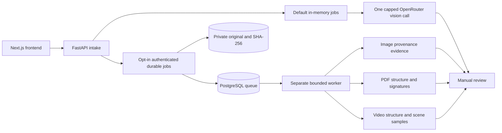

# FraudSight AI

FraudSight AI is an in-progress evidence screening application for images, videos, and PDFs. It records what was inspected, what could not be checked, and where a reviewer should look. **No current path proves that media is AI-generated or that a claim is fraudulent.** Results require human review.

The [public site](https://multimodal-fraud-detector-1.onrender.com/) runs the older screening deployment. The newer durable backend and evidence pipelines in this repository are opt-in and have **not been verified on that site**. This distinction matters when comparing a local result with the live product.

## Current architecture



The default path sends a bounded visual sample to one approved OpenRouter model and returns a **provisional** `Real`/`Fake` screening label. Its confidence is self-reported and uncalibrated. Metadata is context, not an independent authenticity signal. The former judge–critic jury was retired because multiple critics reading the same first-model prose did not provide independent evidence. No Featherless subscription is required.

The durable path stores a versioned job and original hash, then routes each format to separate evidence tasks. It needs a PostgreSQL database, private R2/S3 storage, tenant tokens, and a separately deployed worker for production use. SQLite and local artifacts are development fallbacks. The existing browser frontend does not yet provide the server-side tenant authentication boundary needed for a public durable rollout. See the [durable backend guide](docs/PHASE1_DURABLE_BACKEND.md).

| Modality | Opt-in evidence available in this branch | What it establishes | Still needed for detection |
| --- | --- | --- | --- |
| Image | Original-byte provenance observations | Whether supported C2PA credentials can be checked | Rights-cleared pixel and local-edit detectors, held-out evaluation |
| PDF | Bounded structure, page coverage, and offline signature/revision checks | Document structure and cryptographic integrity under configured trust roots | OCR, cited fields, document-specific rules, and measured error rates; follow-on work is in separate draft PRs |
| Video | Container/stream metadata plus bounded scene scan and timestamped frame hashes | What the worker sampled and where decoding failed | Tested generated-video and face-manipulation detectors with segment-level evaluation |

An absent C2PA manifest, unsigned PDF, editor tag, low frame rate, or missing EXIF is **not** evidence of fraud. A valid signature establishes integrity under its trust configuration, not the truth of a document's contents. The video path does not inspect audio or classify frame content. Evidence paths return `Unknown`, `manual_review`, and zero paid model calls. See [image](docs/PHASE2_IMAGE_EVIDENCE.md), [PDF structure](docs/PHASE3_PDF_EVIDENCE.md), [PDF signatures](docs/PHASE3_PDF_SIGNATURE_EVIDENCE.md), [video structure](docs/PHASE4_VIDEO_STRUCTURE_EVIDENCE.md), and [video sampling](docs/PHASE4_VIDEO_SAMPLING.md) for exact limits and result contracts.

## Development status and next gates

1. **Pipeline plumbing:** versioned jobs, tenant isolation, idempotency, bounded file handling, retry rules, deletion, and typed evidence coverage have automated tests. Local fixture tests check behavior; they do not measure detection accuracy.
2. **Video sampling:** `video-evidence-v2` scans eligible short clips at six frames per second, plans three time anchors plus up to three scene cuts, and records hashes and source timestamps for up to six temporary frames. It reports incomplete scans and failed frame positions. Its rollout requires `VIDEO_EVIDENCE_PIPELINE_ENABLED=1` and `VIDEO_SAMPLING_PIPELINE_ENABLED=1` on a v2-capable worker.
3. **Detector evaluation:** build a consented, rights-cleared, labeled dataset for each question: fully generated image/video, local image edits, face manipulation, and document-specific inconsistencies. Measure false positives, recall, calibration, coverage, p95 latency, and cost on held-out sources and transformations before promoting a detector or score.
4. **Product rollout:** deploy the durable worker and private storage, add the frontend authentication boundary and evidence-linked review UI, then verify the live service in a small authenticated cohort. The public frontend still needs redesign around the actual evidence and skipped checks.

The [implementation plan](docs/MULTIMODAL_DETECTION_IMPLEMENTATION_PLAN.md) contains phase gates. The [architecture review](docs/DETECTOR_ARCHITECTURE_REVIEW.md) explains the research and why a model jury is not the product decision layer. [technical_report.md](technical_report.md) describes the original hackathon system, not the current rollout.

## Cost and safety controls

- Deterministic evidence tasks make no model call. The legacy screening path uses at most one approved, capped vision request per item; an OpenRouter account hard spending limit is still needed before public use.
- The durable API applies tenant tokens, quotas, size and MIME checks, idempotency, private storage, and a worker heartbeat. Its reserved-cost quota is an admission control, not a guaranteed provider billing ceiling.
- PDF and video parser children have CPU, memory, output, and time limits. Unsupported inputs and uninspected portions are reported explicitly.
- All current decisions stay in manual review. Analytics from older screening labels must not be interpreted as validated fraud detection rates.

## Local setup

Prerequisites: Python 3.10+, Node.js 18+, FFmpeg/FFprobe for video, and Poppler for PDF rendering. The video and PDF system packages are installed by this branch's container build and CI; install them separately for local runs. The separate draft PDF OCR branch also needs Tesseract English.

```bash
git clone https://github.com/adimalkar/multimodal-fraud-detector.git
cd multimodal-fraud-detector
python3 -m venv venv
source venv/bin/activate
pip install -r requirements.txt
cp .env.example .env
uvicorn backend.app:app --host 127.0.0.1 --port 8000 --reload
```

In another terminal:

```bash
cd frontend
cp .env.local.example .env.local
npm install
npm run dev
```

The frontend is at `http://localhost:3000`; FastAPI documentation is at `http://localhost:8000/docs`. Set `NEXT_PUBLIC_API_URL` in the frontend environment to the backend URL. For the default paid screening path, configure `OPENROUTER_API_KEY` **only on the backend**. To run the durable path locally with a development token and local artifacts, follow the [Phase 1 guide](docs/PHASE1_DURABLE_BACKEND.md); its flags are not suitable as a public deployment configuration.

Check the backend and local preprocessing without a paid model request:

```bash
python scripts/check_backend.py http://localhost:8000 --allow-unconfigured
python scripts/check_media_pipeline.py --preprocess-only
python -m pytest -q
python -m ruff check . --select=E9,F63,F7,F82
```

`python scripts/check_media_pipeline.py http://localhost:8000` exercises provider-backed jobs and can spend credits. It checks response shape, not detector accuracy. Frontend checks are `npm run type-check`, `npm run lint`, and `npm run build` from `frontend/`.

## API and deployment

The main legacy-compatible API uses `POST /api/analyze`, `GET /api/jobs/{job_id}`, `POST /api/batch/analyze`, `GET /api/batch/{batch_id}`, `GET /api/health`, and `GET /api/ready`. The durable path retains these job endpoints with authenticated, tenant-scoped reads and versioned internal queues. Its production mode disables routes that would bypass ownership, including arbitrary URL intake, public presigned uploads, synchronous analysis, and global analytics. Inspect `/docs` on the running service for its actual enabled contract.

See [DEPLOYMENT.md](DEPLOYMENT.md) and the [durable backend rollout guide](docs/PHASE1_DURABLE_BACKEND.md) before changing hosting settings. The checked-in `render.yaml` describes a web service; it does not provision the PostgreSQL database, private bucket, or separate durable worker. A successful frontend preview or container build does not establish that the public site runs these opt-in branches.

GitHub Actions in [.github/workflows/ci.yml](.github/workflows/ci.yml) run Python tests/lint, frontend checks, and a container build for pull requests, including stacked PRs. The video fixture tests use real FFmpeg commands; the model and detection release gates require separate labeled evaluation.

## License

The bundled frontend template has an [MIT license](frontend/LICENSE) naming Pedro Estevão. There is currently no license file at the repository root for the project as a whole.
